<a href="https://www.sunnybagal.com">
  <picture>
    <source media="(max-width: 600px) and (prefers-color-scheme: dark)" srcset="assets/header-dark-narrow.svg">
    <source media="(max-width: 600px)" srcset="assets/header-light-narrow.svg">
    <source media="(prefers-color-scheme: dark)" srcset="assets/header-dark.svg">
    
  </picture>
</a>

I build backend systems in TypeScript and PostgreSQL, then load-test them until the numbers hold up. Each project below links to the report its numbers come from.

**Open to backend / SDE-1 roles** · Navi Mumbai, open to Bengaluru, Pune or remote 
[sunnybagal.com](https://www.sunnybagal.com) · [LinkedIn](https://www.linkedin.com/in/sunnybagal) · [X](https://x.com/sunny_b11) · [Email](mailto:sunnybagal.1110@gmail.com)

## Selected work

### [Linea](https://github.com/SunnyBagal/Linea)

**Collaborative whiteboard on an event-sourced sync engine.** An append-only op log drives live sync, replay and undo, and a chaos harness checks for gaps, duplicates and ordering against the database.

TypeScript · Node.js · raw ws · PostgreSQL · Prisma · Next.js · Turborepo 
[Code](https://github.com/SunnyBagal/Linea) · [Live](https://linea.sunnybagal.com) · [Load-test report](https://github.com/SunnyBagal/Linea/blob/main/LOADTEST.md)

<a href="https://github.com/SunnyBagal/Linea/blob/main/LOADTEST.md">
  <picture>
    <source media="(max-width: 600px) and (prefers-color-scheme: dark)" srcset="assets/linea-dark-narrow.svg">
    <source media="(max-width: 600px)" srcset="assets/linea-light-narrow.svg">
    <source media="(prefers-color-scheme: dark)" srcset="assets/linea-dark.svg">
    
  </picture>
</a>

### [Recall](https://github.com/SunnyBagal/Recall)

**RAG link organizer with hybrid retrieval.** pgvector HNSW and Postgres full-text search fused with RRF, evaluated on BEIR SciFact, with 219 tests running against real Postgres and BullMQ.

TypeScript · Bun · Express · PostgreSQL/pgvector · Drizzle · Redis · BullMQ · Claude API · React 
[Code](https://github.com/SunnyBagal/Recall) · [Live](https://recall.sunnybagal.com) · [Eval results](https://github.com/SunnyBagal/Recall/blob/main/recall-backend/eval/RESULTS.md)

<a href="https://github.com/SunnyBagal/Recall/blob/main/recall-backend/eval/RESULTS.md">
  <picture>
    <source media="(max-width: 600px) and (prefers-color-scheme: dark)" srcset="assets/recall-dark-narrow.svg">
    <source media="(max-width: 600px)" srcset="assets/recall-light-narrow.svg">
    <source media="(prefers-color-scheme: dark)" srcset="assets/recall-dark.svg">
    
  </picture>
</a>

### [TraceHound](https://github.com/SunnyBagal/TraceHound)

**AI pull-request reviewer, benchmarked against CodeRabbit and Greptile.** Built with coding agents on an open model. I pre-registered a blind, hand-graded benchmark on 29 real-bug PRs and published the full result, including where it lost.

TypeScript · Node.js · TypeScript Compiler API · GitHub Actions · Nemotron (Nebius) · Next.js 
[Code](https://github.com/SunnyBagal/TraceHound) · [Live](https://tracehound-tau.vercel.app) · [Full result](https://github.com/SunnyBagal/TraceHound/blob/main/docs/bench/ts-heldout.md)

<a href="https://github.com/SunnyBagal/TraceHound/blob/main/docs/bench/ts-heldout.md">
  <picture>
    <source media="(max-width: 600px) and (prefers-color-scheme: dark)" srcset="assets/tracehound-dark-narrow.svg">
    <source media="(max-width: 600px)" srcset="assets/tracehound-light-narrow.svg">
    <source media="(prefers-color-scheme: dark)" srcset="assets/tracehound-dark.svg">
    
  </picture>
</a>

## Stack

<picture>
    <source media="(max-width: 600px) and (prefers-color-scheme: dark)" srcset="assets/stack-dark-narrow.svg">
    <source media="(max-width: 600px)" srcset="assets/stack-light-narrow.svg">
    <source media="(prefers-color-scheme: dark)" srcset="assets/stack-dark.svg">
    
  </picture>

## Also

- **InteleCorp Software India** (Jan–Apr 2026): led a four-intern team building GeoGrid, a lead-generation platform. Designed a Redis cell cache that serves repeat searches in 1–3 ms.
- **HackerRank Orchestrate** (Oct 2026, 24-hour solo AI-agent hackathon): rank 238 of 4,094, top 6%.

<samp>Build something. Understand it. Make it better.</samp>

