<a href="https://www.sunnybagal.com">
  <picture>
    <source media="(max-width: 600px)" srcset="assets/header-narrow.svg">
    
  </picture>
</a>

I build backend systems in TypeScript and Postgres, load-test them, and publish the numbers.

**Open to backend / SDE-1 roles** · [sunnybagal.com](https://www.sunnybagal.com) · [LinkedIn](https://www.linkedin.com/in/sunnybagal) · [X](https://x.com/sunny_b11) · [Email](mailto:sunnybagal.1110@gmail.com)

## Projects

<a href="https://github.com/SunnyBagal/Linea">
  <picture>
    <source media="(max-width: 600px)" srcset="assets/linea-title-narrow.svg">
    
  </picture>
</a>

A multiplayer whiteboard in the spirit of Excalidraw. Every stroke, move and undo is an operation in one append-only log, so live sync, per-user undo and time-travel replay all come from the same source. I load-tested it with 20 concurrent clients and a chaos harness that checks the database for gaps, duplicates and out-of-order ops.

[Code](https://github.com/SunnyBagal/Linea) · [Live](https://linea.sunnybagal.com) · [Load-test report](https://github.com/SunnyBagal/Linea/blob/main/LOADTEST.md)

<a href="https://github.com/SunnyBagal/Linea/blob/main/LOADTEST.md">
  <picture>
    <source media="(max-width: 600px)" srcset="assets/linea-narrow.svg">
    
  </picture>
</a>

<a href="https://github.com/SunnyBagal/Recall">
  <picture>
    <source media="(max-width: 600px)" srcset="assets/recall-title-narrow.svg">
    
  </picture>
</a>

Save a link and it becomes a rich card (a YouTube player, a tweet, a GitHub repo, an article summary) that you can search by meaning as well as keywords. Search fuses pgvector and Postgres full-text results, and you can ask questions about your saved links and get cited answers. Ingestion runs on BullMQ workers with retries, and search quality is measured on the public BEIR SciFact benchmark.

[Code](https://github.com/SunnyBagal/Recall) · [Live](https://recall.sunnybagal.com) · [Eval results](https://github.com/SunnyBagal/Recall/blob/main/recall-backend/eval/RESULTS.md)

<a href="https://github.com/SunnyBagal/Recall/blob/main/recall-backend/eval/RESULTS.md">
  <picture>
    <source media="(max-width: 600px)" srcset="assets/recall-narrow.svg">
    
  </picture>
</a>

<a href="https://github.com/SunnyBagal/TraceHound">
  <picture>
    <source media="(max-width: 600px)" srcset="assets/tracehound-title-narrow.svg">
    
  </picture>
</a>

A GitHub Action that reviews TypeScript pull requests on an open model. One reviewer reads only the diff, a second also reads the code that references what changed, and a verifier keeps or drops each finding before one review is posted. I benchmarked it blind against CodeRabbit and Greptile on 29 real-bug PRs: it caught fewer bugs but left far less noise, at about $0.06 a review.

[Code](https://github.com/SunnyBagal/TraceHound) · [Live](https://tracehound-tau.vercel.app) · [Full result](https://github.com/SunnyBagal/TraceHound/blob/main/docs/bench/ts-heldout.md)

<a href="https://github.com/SunnyBagal/TraceHound/blob/main/docs/bench/ts-heldout.md">
  <picture>
    <source media="(max-width: 600px)" srcset="assets/tracehound-narrow.svg">
    
  </picture>
</a>

## Stack

<picture>
    <source media="(max-width: 600px)" srcset="assets/stack-narrow.svg">
    
  </picture>

## Experience & Achievements

<picture>
    <source media="(max-width: 600px)" srcset="assets/experience-narrow.svg">
    
  </picture>
