<a href="https://www.sunnybagal.com">
  <picture>
    <source media="(max-width: 600px)" srcset="assets/header-narrow.svg">
    
  </picture>
</a>

I build backend systems in TypeScript and Postgres, load-test them, and publish the numbers.

**Open to backend / SDE-1 roles** · [sunnybagal.com](https://www.sunnybagal.com) · [LinkedIn](https://www.linkedin.com/in/sunnybagal) · [X](https://x.com/sunny_b11) · [Email](mailto:sunnybagal.1110@gmail.com)

### Projects

**[Linea](https://github.com/SunnyBagal/Linea)**: a collaborative whiteboard on an event-sourced sync engine · [live](https://linea.sunnybagal.com) · [load test](https://github.com/SunnyBagal/Linea/blob/main/LOADTEST.md)

<a href="https://github.com/SunnyBagal/Linea/blob/main/LOADTEST.md">
  <picture>
    <source media="(max-width: 600px)" srcset="assets/linea-narrow.svg">
    
  </picture>
</a>

**[Recall](https://github.com/SunnyBagal/Recall)**: a RAG link organizer with hybrid search on pgvector · [live](https://recall.sunnybagal.com) · [eval](https://github.com/SunnyBagal/Recall/blob/main/recall-backend/eval/RESULTS.md)

<a href="https://github.com/SunnyBagal/Recall/blob/main/recall-backend/eval/RESULTS.md">
  <picture>
    <source media="(max-width: 600px)" srcset="assets/recall-narrow.svg">
    
  </picture>
</a>

**[TraceHound](https://github.com/SunnyBagal/TraceHound)**: an AI PR reviewer, blind-tested vs CodeRabbit and Greptile · [live](https://tracehound-tau.vercel.app) · [result](https://github.com/SunnyBagal/TraceHound/blob/main/docs/bench/ts-heldout.md)

<a href="https://github.com/SunnyBagal/TraceHound/blob/main/docs/bench/ts-heldout.md">
  <picture>
    <source media="(max-width: 600px)" srcset="assets/tracehound-narrow.svg">
    
  </picture>
</a>

### Stack

<picture>
    <source media="(max-width: 600px)" srcset="assets/stack-narrow.svg">
    
  </picture>

Previously led a four-intern team building GeoGrid at InteleCorp · HackerRank Orchestrate: rank 238 of 4,094
